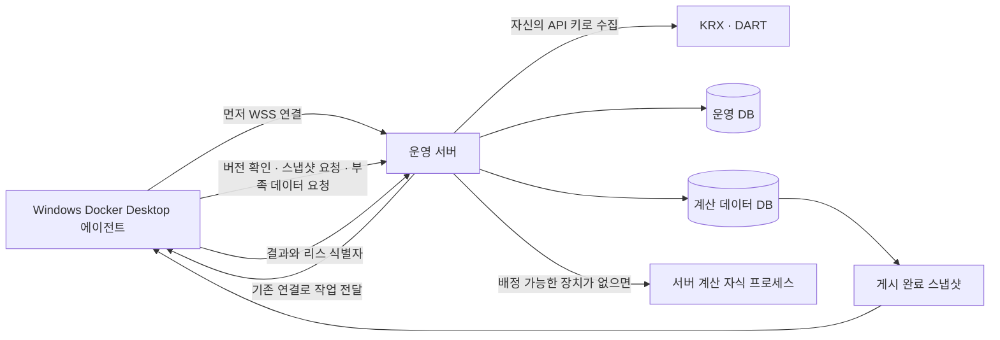

# 계산 에이전트 운영

Windows Docker Desktop의 Linux 컨테이너에서만 외부 에이전트가 상주한다. Linux 런타임은 이미지 내부에서 실행하며 사용자가 Linux/WSL2에 네이티브 설치하지 않는다. 부모 프로세스가 서버 연결,
데이터 캐시, 자원 측정과 결과 재전송을 담당하고 유니버스·백테스트는 자식 프로세스에서 계산한다.
장치 SSH 배포, worker.env, GPU 실행은 사용하지 않는다.

명칭은 다음과 같이 구분한다.

| 명칭 | 책임 | 코드 |
| --- | --- | --- |
| agent | N개의 worker 관리, 서버 연결, 자원·캐시·재전송 관리 | `src/agent/`, 서버 `AgentCoordinator` |
| worker | 동시에 하나의 job 계산 | `src/runtime/workers/backtest-child.ts`, `preparation-child.ts` |
| 임대 관리 | 어느 agent가 작업을 맡았는지와 만료·완료 검증 | `BacktestLeaseService`, `backtest_jobs.agent_id` |

작업 전용 내부 환경 인자는 에이전트가 자식을 만들 때 전달한다. 예를 들어
`WORKER_MAX_BARS`는 자동 측정한 worker당 한도이며 사용자가 작성하는 설정 파일이 아니다.



<a id="windows-docker-desktop"></a>
## Windows Docker Desktop 설치와 업데이트

1. 운영 웹의 **설정 → Agent**에서 장치 이름으로 연결 토큰을 발급한다.
2. 같은 토큰 카드의 **Windows Docker Desktop 설치 파일**을 다운로드한다.
3. `quant-agent-windows.cmd`를 실행한다. Docker Desktop이 없으면 winget으로 설치하고,
   설치되어 있으면 시작한 뒤 Linux 엔진을 기다린다. Windows 기능 설정·UAC·최초 약관 확인·
   재부팅 안내가 나오면 해당 절차를 마친 뒤 같은 설치 파일을 다시 실행한다.
4. 최신 이미지를 받은 뒤 컨테이너가 실행된다. 웹에서 장치의 최근 연결을 확인한다.

설치기는 로컬 `desktop-linux` 컨텍스트만 사용한다. 원격 Docker 호스트, Windows 컨테이너와
HTTP 로컬 개발 서버는 지원하지 않는다. 운영 서버의 HTTPS 주소에 접근할 수 있어야 한다.
인바운드 포트는 필요 없다. Windows x64/ARM64에서 각각 Linux amd64/arm64 이미지를 받는다.

설치 파일에 서버 주소·토큰이 포함되므로 공유하지 않는다. 토큰은 `docker run`에만
`QUANT_AGENT_SERVER_URL`, `QUANT_AGENT_TOKEN` 환경변수로 전달하며 이미지나 캐시 볼륨의
`settings.json`에 저장하지 않는다. Docker 관리자는 컨테이너 환경변수를 확인할 수 있다.

컨테이너 이름은 `quant-agent-<토큰 SHA-256 앞 12자리>`, 볼륨은 같은 이름 뒤의 `-state`다.
같은 설치 파일을 다시 실행하면 반드시 latest를 pull하고 확인한 이미지 ID로 교체한다.
다운로드에 실패하면 기존 컨테이너를 보존한다. 캐시·미전송 결과는 named volume의
`/var/lib/quant-agent`에 남는다. 새 토큰으로 설치하면 별도 장치와 볼륨을 만든다.

UID 1000과 `unless-stopped` 재시작 정책을 사용한다. Windows 로그인 시 Docker Desktop
자동 시작을 켜 둔다. Windows 절전·종료와 Docker Desktop 종료 중에는 계산할 수 없다.
컨테이너는 실행 파일을 자체 업데이트하지 않는다. 서버와 버전이 다르면 작업을 중단하고
최신 이미지 설치를 안내하므로 보관한 설치 파일을 다시 실행한다.

## GHCR 이미지 게시와 두 버전 보존

기본 이미지는 `ghcr.io/sa04108/quant-agent:latest`다. 다른 계정으로 배포하면 workflow의
이미지 경로와 서버의 `AGENT_CONTAINER_IMAGE=ghcr.io/<계정>/<이미지>:latest`를 함께 맞춘다.
최초 게시 후 GitHub Packages에서 이미지 패키지의 visibility를 **Public**으로 설정해야
로그인 없이 설치할 수 있다. 연결된 저장소의 Actions에 패키지 관리 권한도 필요하다.

main push 또는 수동 실행으로 시작하는 **Deploy production** workflow는 Windows PowerShell 설치 시나리오를 검증하고,
`.node-version`과 같은 Node로 두 아키텍처 이미지를 빌드한다. 후보 이미지의 실제 실행을
확인한 뒤 서버를 배포한다. 성공하면 기존 latest를 previous로 보존하고 후보를 latest로
승격한다. 후보 태그는 `v-<agentVersion>`이며, 사용자 설치기는 latest만 선택한다.
서버 배포 실패 시 후보를 정리하고 기존 latest/previous를 보존한다.

`scripts/publish-agent-image.mjs`는 latest·previous **두 릴리스**와 이들이 참조하는
아키텍처 manifest·빌드 증명만 남긴다. 첫 게시에는 latest 하나만 있다. 하위 manifest는
별도 실행 버전이 아니므로 Packages의 항목 수는 2보다 많을 수 있다.
삭제가 거부되면 workflow도 실패하며 정리 성공으로 처리하지 않는다. GitHub는 공개 버전의
다운로드가 5,000을 넘으면 삭제를 제한하므로 해당 경우 GitHub 지원이 필요하다.

백업 복구 시 previous의 digest와 서버 agentVersion을 확인하고 서버도 같은 실행 코드로
복원한다. 게시 권한 환경의 `AGENT_IMAGE`, `GH_TOKEN`, `GITHUB_ACTOR`, `GITHUB_REPOSITORY`,
`GITHUB_REPOSITORY_OWNER`를 설정해 다음 명령을 실행한다. 사용자 설치기는 복구 후에도 latest를 받는다.

```bash
node scripts/publish-agent-image.mjs --promote sha256:<복구할-digest>
# 현재 latest/previous를 보존하며 실패 후보를 정리한다.
node scripts/publish-agent-image.mjs --prune-only
```

## 컨테이너 상태와 자원 관리

설치 파일은 토큰 발급 후 웹에서 다운로드한다. 연결 토큰은 CMD 파일에 포함되며 한 번만 표시되므로 파일을 보호한다. 같은 CMD 파일을 다시 실행하면 최신 이미지를 pull해 컨테이너를 교체한다. 서버 주소와 토큰은 컨테이너 실행 때 `QUANT_AGENT_SERVER_URL`, `QUANT_AGENT_TOKEN` 환경변수로 전달하고 named volume의 파일이나 이미지에는 넣지 않는다.

컨테이너 이름은 `quant-agent-<토큰 SHA-256 앞 12자리>`, 데이터 볼륨은 이름 뒤에 `-state`를 붙인다. `/var/lib/quant-agent`에 로컬 스냅샷 캐시, 작업 상태, 전송 대기 결과를 보관한다. 재설치·이미지 업데이트는 이 볼륨을 유지한다. named volume을 직접 지우면 저장된 데이터와 미전송 결과가 함께 삭제된다.

컨테이너는 비 root UID 1000, `unless-stopped` 재시작 정책으로 실행한다. Docker Desktop의 Linux 엔진이 동작하고 있어야 하며 Windows 절전·종료 중에는 작업할 수 없다. 자원 한도는 CPU affinity, cgroup, 시스템 부하, 작업 RSS를 바탕으로 자동 산정하며 사용자가 CPU·메모리·동시성 설정 파일을 만들지 않는다.

상태와 최근 로그는 PowerShell에서 확인한다.

```powershell
docker --context desktop-linux ps --filter "name=quant-agent-"
docker --context desktop-linux logs --tail 100 <컨테이너 이름>
```

## 작업 배정과 로컬 실행

새 작업은 필요한 데이터 버전과 자원을 갖춘 유휴 에이전트에 먼저 배정한다. 배정할
에이전트가 없으면 타임아웃을 기다리지 않고 운영 서버의 계산 자식 프로세스를 사용한다.
원격 장치와 운영 서버 모두 여유가 없을 때만 큐에 대기한다. 이미 모든 슬롯을 사용하는
에이전트도 새 작업을 받을 수 없으므로 같은 로컬 실행 기준을 적용한다.

큐 등록, 에이전트 연결 후 준비 완료, 슬롯 통지, 작업 완료와 데이터 대기 해제 이벤트가
배정을 즉시 깨운다. 2초 주기 점검은 복구용 보조 경로다. 대기 작업을 배정할 때마다
원격 장치를 먼저 확인하며, 연결이 끊긴 장치의 유효한 리스를 로컬에서 중복 실행하지 않는다.
나중에 에이전트가 연결돼도 이미 시작한 로컬 계산은 완료까지 유지한다.

서버 내부 실행기는 같은 에이전트의 계산·리스·결과 검증 코드를 사용한다. 내부 메시지와
게시된 읽기 전용 스냅샷을 직접 사용하므로 서버 자신에게 WSS를 연결하거나 DB 파일을
다시 다운로드하지 않는다. 별도 설치, 장치 토큰 또는 worker.env 설정은 필요 없다.
작업 상태와 전송 대기 결과는 계산 DB 옆 `server-agent/`에 보존한다.

1 GB 운영 서버의 서비스 제한은 `MemoryHigh=512M`, `MemoryMax=640M`을 유지한다.
로컬 계산은 CPU 수와 관계없이 동시에 한 개다. 물리 RAM과 현재·상위 cgroup의
`memory.high`/`memory.max` 중 작은 값을 운영 예산으로 보고 절반을 API에 남긴다.
API의 현재 RSS는 가용량에서 이미 빠졌으므로, 추가 성장 여유
`max(64 MiB, 운영 예산/2 - API RSS)`만 차감한다. 워커 예산은 남은 가용량과 운영
예산의 절반 중 작은 값이다. 기본 운영 설정에서는 워커 RSS 최대 256 MiB,
V8 old-space 최대 166 MiB다. API 사용량·다른 자식·시스템 여유가 부족하면 더 줄거나 대기한다.

스냅샷 조회 후 남는 깨끗한 비활성 파일 캐시는 회수 가능한 용량으로 계산하되 쓰기 미완료·
활성 캐시는 제외한다. 이 추정과 별도로 실제 `memory.max` 및 장치 가용량을 확인한다.
Node의 `availableMemory()`는 `memory.high`도 반영하므로 v2 직접 측정의 하드 여유에 재사용하지 않는다.
v1 또는 유효한 v2 측정이 없는 환경에서는 Node의 가용량·제한량으로 보수적으로 되돌아간다.
로컬 자식을 만들기 직전에도 자원과 기존 자식 수를 재확인하며, 실행 중 250 ms마다
API RSS·가용량·워커 RSS를 검사한다. API가 운영 예산의 절반에 도달하거나 운영 여유가
32 MiB 미만, 실제 하드 여유가 64 MiB 미만이면 워커를 즉시 종료한다. 워커 자체 RSS가
시작 때 정한 예산을 넘는 경우도 같다. 자원 중단은 `RESOURCE_BUDGET_EXCEEDED`로 보고한다.
CPU 여유분과 낮은 계산 우선순위도 유지한다.

기본 실행 슬롯은 128 MiB부터 검사한다. 로컬 백테스트는 추가로 고정 입력 크기·종목 수·
전략 이력·기간별 결과·재무 입력과 안전 여유를 반영한 작업별 메모리 계획을 검사한다.
가격 전략은 재무를 적재하지 않는다. 재무 전략의 로컬 실행은 검증과 계산 모두 한 종목씩
읽고, 현재 봉 시각과 종목별 마지막 실행 시각까지의 공시만 조회한다. 계획에는 전체
재무 행 수 대신 가장 큰 한 종목의 행 수를 반영한다. 자본변동은 접수일과 관계없이
전체 이력을 읽어 효력일 정렬과 가격·수량 보정을 유지한다.
로컬 워커의 작업 DB와 데이터 DB 페이지 캐시는 각각 예산의 1/128로 제한한다
(DB당 최소 2MiB, 최대 16MiB). 이 설정은 연결에만 적용한다.
배정과 자식 생성 직전이 같은 계획을 사용하며, 256 MiB 아래에서도 필요량을 충족하면
실행한다. 봉 총량으로 로컬 메모리 한도를 환산하지 않는다. 시작 직전 부족해지면 실패
횟수를 늘리지 않고 대기로 반환하고, 로컬 재배정을 15초 보류한 뒤 다시 검사한다.
대기 중인 큰 작업이 실행 가능한 작은 작업이나 준비 작업을 막지 않는다.
이 추정은 완료를 보장하지 않으며 과거 다른 작업의 최대 RSS를 다음 작업에 적용하지 않는다.
원격 agent는 요청 봉 수×1280과 관측 RSS×1.35, 최소 256 MiB 또는 RAM 10% 여유분,
병렬 배정과 일반 취소 경로를 사용한다. 정상 종료는 서버 자식 종료를 확인한
뒤 로컬 리스를 반환하며 비정상 종료 후 남은 리스는 만료 절차를 따른다.

API와 자식은 같은 cgroup에 있으므로 위 정책은 커널의 프로세스별 메모리 격리가 아니다.
폴링 사이의 급격한 할당이나 동기 API 처리를 포함해 응답 지연이 전혀 없다고 보장하지는 않는다.
제한 환경의 실제 검증과 범위는 [1 GB 운영 메모리 검증](local-worker-memory-verification.md)을 따른다.

수집은 연도·종목·거래일 단위 사이에 이벤트 루프를 양보한다. DART 응답 캐시는 현재 요청과
직전 연도 앵커 범위만 유지하고, 이전 원문은 영속 저장소에서 재사용한다. 미리보기 자본변동
검증은 32종목씩 전체 이력을 읽어 결과를 보존하면서 임시 원본의 동시 적재량을 제한한다.
기업코드 원문·해시·정체성 이력 검증은 유지하며 파싱 결과를 재사용한다.

계산 DB 게시 시 복사 전에 허용 테이블을 확인하고 복사본에서도 무결성 검사를 유지한다.
동일한 dataset/revision/수집 버전 게시 실패는 30초 동안 재시도를 보류하며, revision이
변경되면 즉시 다시 시도한다. 측정 조건과 한계는 [메모리 개선 검증](preview-memory-verification.md)을 따른다.
게시 검증 연결은 페이지 캐시 16,000KiB와 최대 2GiB의 `mmap_size`를 사용한다. 매핑 상한은
상주 메모리 제한이 아니며 SQLite가 지원하지 않거나 상한을 넘는 구간도 전체 검사한다.
`dataset_publish.*` 단계별 시간·CPU·RSS·Linux I/O 지표는 기존 Pino·journald 로그에서
확인한다. `/proc` 읽기나 진단 전달 실패가 게시를 막지 않는다. 동일한 fact payload는
UPSERT를 생략하지만 수집 watermark 완료 시각은 계속 갱신한다.
실측과 재현 방법은 [계산 스냅샷 게시 I/O 검증](snapshot-publish-performance.md)을 따른다.

## 연결 중단과 재시도

WSS는 TLS 위의 WebSocket 연결이다. PC에서 운영 서버의 HTTPS 포트로 연결하므로 PC의
인바운드 포트를 열지 않는다. 서버는 연결로 작업을 보내며 파일은 인증된 HTTPS로 전송한다.

- 재접속: 지수 백오프와 무작위 지연, 약 1~30초.
- 작업 리스: 90초, heartbeat 15초. 일시 단절 후 유효한 리스는 계속 사용할 수 있다.
- 리스 만료: 클라이언트는 계산을 취소하고 서버는 다시 배정한다. 계산 연결 실패 3회면 실패한다.
- 식별자: 장치·작업·attempt·새 난수 lease token을 대조한다. 이전 시도의 늦은 결과는 거부한다.
- 결과 응답 유실: 디스크 outbox에서 재전송한다. 같은 완료 결과는 중복 저장하지 않는다.
- 사용자 취소: 연결로 전달하고 자식 IPC → 2초 뒤 SIGTERM → 5초 뒤 SIGKILL 순서로 종료한다.
- 서버가 요구하는 `agentVersion` 변경: 이전 리스를 폐기하고 작업을 재배정한다. 클라이언트는 계산·업로드를
  정리한 뒤 새 파일의 해시와 실행 검사를 통과해야 현재 버전을 교체한다. 업데이트는 계산 실패로 세지 않는다.

웹에서 장치를 해제하면 토큰과 연결이 더 이상 작업·데이터에 접근하지 못한다. 이미 장치에
다운로드한 계산 데이터 파일을 원격으로 회수하는 기능은 없다.

## 데이터 버전과 부족 데이터 처리

운영 서버의 `app.sqlite`에는 계정, 세션, API 사용량, 수집 큐, 작업·결과를 저장한다.
`app.data.sqlite`에는 가격, 종목 이력·구성, 재무·자본변동 facts, 벤치마크와 각 데이터의
커버리지만 저장한다. 정확한 테이블 경계는 `database-tables.ts`와 각 Drizzle 스키마가 정의한다.
원본 API 응답 캐시와 인증 정보는 배포하지 않는다. 장치는 운영 DB나 공급자 API에 직접 접근하지 않는다.

계산 DB의 변경 revision과 **게시 버전**을 구분한다. 서버는 별도 프로세스로 SQLite backup을
생성하고 테이블 경계·무결성·해시를 확인한 뒤 latest 명세를 원자적으로 교체한다. 복원으로
원본 revision이 낮아져도 게시 버전은 증가한다. 매 작업 배정 전에 최신 게시 버전을 확인한다.
동일 파일은 재다운로드하지 않으며 새 파일을 검증한 뒤 캐시를 교체한다. 실행 중 작업은
시작할 때의 스냅샷을 유지한다. 서버는 현재·직전·실행 리스가 참조하는 스냅샷을 보존한다.

유니버스 계산 중 부족한 날짜·등록 종목·재무 연도 등을 만나면 클라이언트가 수집 요구를
보낸다. 서버는 동일 요구를 합쳐 영속 큐에 넣고 자신의 API 키와 quota 정책으로 수집한다.
해당 작업은 `WAITING_DATA`로 전환하고 계산 슬롯을 반환한다. 다른 준비된 작업을 실행할 수 있다.
수집 완료와 새 스냅샷 게시 이후 대기 작업을 재개한다. 데이터 대기는 계산 실패 횟수를
소모하지 않으며, quota 소진은 다음 허용 시각까지 대기한다. 공급자 응답으로도 결손이
계속 남으면 무한 재수집하지 않고 오류를 기록한다.

## DB 마이그레이션과 복원

`DATABASE_PATH`는 운영 파일이며 계산 파일 경로는 자동으로 `*.data.sqlite`로 결정한다.
각 파일은 `migrations/operations`, `migrations/data`의 독립 마이그레이션 이력을 가진다.
배포는 서비스를 중지하고 두 DB를 백업한 뒤 새 릴리스의 `db:prepare`를 실행한다.
`db:prepare`는 systemd oneshot 작업으로 실행하여 중단 신호를 배포 실패로 처리한다.
SSH 연결 유지 패킷과 응답 제한으로 긴 검증 중 연결 단절도 감지한다.

```bash
# 운영 서버에서는 서비스 중지 및 app.env를 읽는 systemd-run 절차를 먼저 적용한다.
pnpm cli db:backup /안전한경로/before.sqlite
pnpm cli db:prepare
# 복원이 필요하면 서비스를 멈춘 상태에서 실행한다.
pnpm cli db:restore /안전한경로/before.sqlite
```

백업 세트는 `before.sqlite`, `before.sqlite.data`, `before.sqlite.json` 세 파일이다.
복원은 모든 해시를 먼저 확인하고 임시 파일과 복원 기록으로 진행한다. 중단되면 같은
`db:restore`를 다시 실행한다. 복원 기록이 남았거나 연결된 파일이 없거나 데이터셋 식별자가
다르면 앱은 부팅하지 않는다. SQLite WAL의 여러 파일 쓰기를 하나의 원자적 트랜잭션으로
간주하지 않으며, 유지보수 중 모든 쓰기를 중지한다.

일회성 단일 DB 분리 코드는 전환 릴리스 `040ef56`에 남아 있다. 현재 릴리스는 이미 분리된
DB 또는 새 DB만 지원한다. 분리 전 백업을 복원해야 한다면 해당 전환 릴리스의 CLI로
복원·분리를 먼저 완료한다. 분리 당시 보존한 원본 백업과 해당 릴리스를 함께 보관한다.

데이터 마이그레이션 `0001_retire_completed_conversions`는 완료된 SCD 변환의 임시 테이블과
사용하지 않는 `symbol_facts_state.updated_at_ms`를 삭제한다. 미변환 체크포인트·이벤트나
PENDING 상태의 종목 이력이 있으면 삭제하지 않고 중단한다. 현재 종목 버전, 재무·자본변동의
독립 watermark는 보존한다. 이후 `0002_collection_coverage_version`은 KRX coverage의 수집
실행 출처 컬럼을 추가한다. NULL·이전 값도 재사용하며 현재 해시로 덮어쓰지 않는다.
새 데이터 마이그레이션은 확인된 입력 문제와 관련 revision 처리를 추가하고 새 스냅샷을 게시한다.
에이전트의 실행·스키마 계약이 바뀌면 새 `agentVersion` 이미지로 업데이트한다. 사용자는 같은 Windows CMD 설치 파일을 다시 실행한다.
수집 파서·서버 버전 변경만으로 정상 DB를 재해석하거나 재수집하지 않는다. 실제 결손·손상이
확인된 요청 범위에서만 저장 원문 재사용과 필요한 외부 수집을 수행한다.

## 빌드와 배포

```bash
pnpm build:agent       # Docker 구성·hermetic 검증용 내부 Linux 런타임 archive
pnpm test:agent-package # archive 경계와 실제 준비·백테스트 workload 실행
pnpm run deploy        # 서버만 SSH 배포; 공개 native agent 파일은 빌드·게시하지 않음
```

`deploy.env`에는 `HOST`·`SSH_*` 접속 설정만 있다. 공급자 API 키와 서비스 설정은 서버의
`app.env`에 남는다. 옛 worker 환경변수, 장치별 SSH와 사용자용 native runtime 배포 경로는
제거했다. Docker 이미지는 GHCR에 별도로 게시하며 standalone 서버 배포는 서버와 웹만 전송한다.
실패 시 코드와 DB 백업 세트를 함께 복원한다.


## 기존 명칭의 DB 이행

운영 마이그레이션 `0004_agent_ownership`은 `backtest_jobs.worker_id`를 `agent_id`로
이름 변경하고 값의 `remote:` 접두사를 한 번 제거한다. 상태·attempt·임대 token hash·만료
시각·완료 결과는 보존한다. 새 DB 생성에도 필요한 운영 스키마 이행 순서를 유지한다.
과거 마이그레이션과 결정 이력의 이름은
당시 스키마를 설명하므로 유지한다. 과거 비밀 키 이름의 로그 마스킹도 유지한다.


## 공급자 원문·최신성·자동 수집 운영 (D-096·D-099)

원문과 공시 조회 checkpoint·요청 계획·HTTP 시도 원장은 서버 운영 DB에 보관한다.
계산 DB와 함께 백업·복원하며, 원문·coverage를 지워 재수집을 유도하지 않는다. 정상
legacy 자료는 원문이 없어도 현재 계산에 충분하면 재사용한다. 필요한 원문·필드가 없거나
손상·정정이 확인되면 요청 키와 근거 fingerprint 범위만 자동 수집한다(D-099).
별도 외부 데이터 카드·수집 현황·승인 버튼은 제공하지 않고 기존 작업 진행률만 사용한다.
물리 시도 이력은 보존한다. 연결 실패·HTTP 5xx는 5회 전까지 지수 지연으로 자동 재시도하고, 5회 한도에 이르면 15분 뒤 다음 5회를 자동 예약한다.

DART 본문 갱신은 API별 접수번호를 기준으로 한다(D-102). 같은 번호면 원문을 유지하고,
다른 번호면 대소와 무관하게 교체한다. 목록의 최신 번호와 맞추기 위한 하루 대기나 접수일
목록 재검증은 없다. 이 변경을 배포하고 서버가 시작되면 기존 `PENDING_PUBLICATION`
대기를 재평가하고, 이전 목록 미관측 상태도 복구한다. 호출 한도·네트워크 재시도 기한은
유지한다. 기존 원문과 교체 이력은 삭제하지 않는다.

DART 목록은 미리보기 시작마다 `list.json` 최대 2회, 총 5초만 확인한다(D-098).
서버 시작만으로 새 조회를 만들지 않으며 `DART_DISCOVERY_HOUR_KST` 설정은 없다.
동시 미리보기는 진행 중인 짧은 목록 확인을 공유한다. 이전 완료 경계를 하루 겹쳐 조회하되
최대 최근 80일로 제한하고 그 이전 공백은 별도 수집 이력으로 남긴다. 확인 이력이 없으면
어제부터 시작하며 전체 과거 공시를 확인했다고 표시하지 않는다.
미리보기는 즉시 준비 작업으로 접수하고 목록 확인 종료 후 계산에 배정한다. 실패·시간 초과·
미확인 페이지가 있어도 기존 DB로 진행한다. 완료 결과 읽기는 새 조회를 시작하지 않는다.

미리보기의 짧은 확인이 끝나면 남은 목록을 내부에서 자동으로 처리한다. 1회 작업은 최대
100회·30초로 제한하며 잔여 checkpoint나 오류가 있으면 15분 뒤 이어서 처리한다. 같은 날의 내부 작업과 이미 닫힌 기간은
저장된 커서부터 이어 읽는다. 당시 열린 기간은 날짜가 바뀌면 첫 페이지부터 다시 읽어
추가 접수를 확인하며, 새 미리보기는 항상 최근 구간의 첫 페이지부터 확인한다. 이 수집이 실행 중이어도 새 미리보기는 대기하지 않는다.

최신성 확인은 이번 페이지의 종목·연도·보고서에 대한 작은 메타데이터 조회만 한다.
저장 원문과 기업코드 XML을 읽거나 모든 연도를 해시·파싱하는 단계는 없다. 기존 원문의
새 접수번호 컬럼은 NULL로 유지하며 채우기 위한 전수 재생을 하지 않는다. 반영 여부를
입증할 수 없는 legacy 자료는 미확인 경고와 함께 재사용한다. 확인된 새 공시·입력 결손은
별도 데이터 수집 단계에서 해당 범위만 처리한다. API 반영 대기는 범위별 예약 재시도로,
손상·정정 본문 교체는 D-099의 자동 수집 정책으로 처리한다.

확인 시각·범위·요청 근거는 내부 기록으로만 관리한다.
목록 장애나 확인 이력 없음만으로 기존 검증 데이터의 실행을 막지 않는다. 확인된 손상·정정과
필수 입력 결손은 복구 완료 전까지 해당 범위를 차단한다. 정체성 불일치·해석 불가 공시는 자동 처리하지 않는다. 실행 당시의 최신성 상태는
`provider_execution_provenance`에 고정한다. 자동 복구가 끝난 데이터는 새 revision·스냅샷으로
전달하고 이미 완료된 결과의 입력을 사후 교체하지 않는다.

KRX는 [공식 거래일력](krx-trading-calendar.md)으로 휴장과 게시 전 빈 응답을 구분한다.
구현의 검증 결과와 한계는 [검증 기록](provider-data-reuse-verification.md)을 확인한다. 운영 DB나 실 공급자 API로
자동 smoke를 실행해 검증을 대신하지 않는다.
